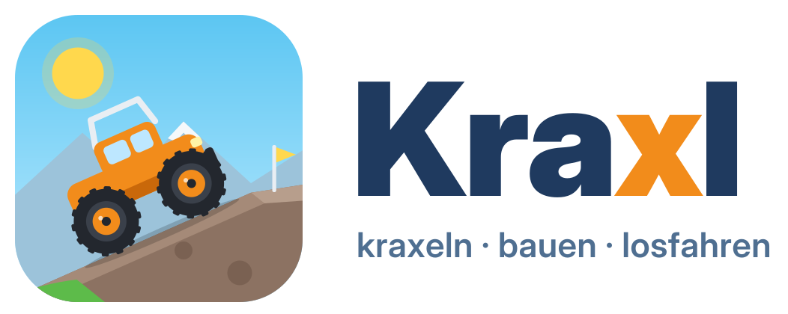

<p align="center">
  <picture>
    <source media="(prefers-color-scheme: dark)" srcset="docs/logo/kraxl-logo-dark.svg">
    
  </picture>
</p>

# Kraxl

Offline-Sandkasten-Fahrspiel für Kinder ab 4 Jahren (Windows + Android), gebaut mit Godot.
Kein Scheitern, keine Werbung, keine Käufe, kein Internet, keine Datenerfassung.

## Status

Spike-Stand (Oktober 2026):
- **Crawler-Baukasten (Garage):** 10 Kategorien mit 54 Teilen und 9 fertigen Vorlagen, alles per Antippen
  oder Gamepad, ohne Text. Darunter **Bagger** und **Radlader** mit beweglichem Arm bzw. Schaufel.
- **3D-Modelle** aus dem Kenney Car Kit (CC0), in der Garage-Farbe lackiert (ADR 0011).
- Licht an/aus, Auspuffrauch (mehr bei Gas), große Touch-Tasten nur auf Touch-Geräten, Entwickler-Anzeige mit F3.
- **Zwei Spieler** mit geteiltem Bildschirm: zwei Gamepads, Tastaturhälften oder Tablet-Hälften (ADR 0012).
- **Bunt:** 13 Lackfarben inkl. Regenbogen, farbige Felgen und Zierteile, Blumenwiese, Kegel und Kisten zum
  Umschubsen.
- **Weltrand:** bunter Zaun; wer trotzdem hinausfällt, steht sofort wieder am Start.
- **Bagger gräbt:** Arm runter = Mulde graben (Erde im Löffel), nochmal runter = Haufen auskippen (ADR 0013).
- **Flieger:** eigener Aufbau, Spielzeug-Flug ohne Absturz (▲ Gas/steigen, ▼ sinken/bremsen, ◀ ▶ Kurve).
- Fahrbares Gelände (Terrain3D) mit Touch-Steuerung, Gamepad (8BitDo SN30 Pro) und FPS-Messung.
- Töne per Code: Motor je Motor-Teil, Ketten-Rattern, Hupe, Plumps, Dreiklang beim Aufstellen, Klicks (ADR 0010).
- **Windows bestätigt:** läuft im Mobile-Renderer (RX 6600 XT, 59 fps), Controller über 8BitDo-Adapter erkannt.
- Der Fahrbot prüft 109 Baupläne; alle Metriken sind grün (Godot 4.7.2 + Jolt + Terrain3D 1.0.2).

Offen ist der Hardware-Test am **Spike-Tag**: Windows und Android im Mobile-Renderer
(Ablauf: [docs/spike/spike-tag.md](docs/spike/spike-tag.md)).

## Technik-Eckdaten

| Bereich | Festlegung |
|---|---|
| Engine | Godot **4.7.2-stable** (Rückfallebene 4.6.3), siehe `.tool-versions` |
| Physik | Jolt Physics (explizit gesetzt), 120 Ticks/s, Physik-Interpolation an |
| Fahrzeuge | Eigener Rad-Controller mit ShapeCast3D + „Parkbremse“, kein VehicleBody3D |
| Renderer | Mobile (Windows und Android) |
| Terrain | Terrain3D 1.0.2-stable (per Skript gepinnt), max. 8 Boden-Texturen ≤ 1024² |
| Steuerung | „Kleine Hände“: große Halte-Tasten, Auslösen bei Touch-Down; Gamepad (8BitDo SN30 Pro, ADR 0009); Tastatur |
| Baukasten | Teile als Daten (`part_catalog.gd`), jede Kombination muss die Fahrbot-Pflichtwerte bestehen (ADR 0008) |
| Tests | Fahrbot inkl. Baukasten-Matrix + UI/Gamepad-Test (headless, CI), später GUT |
| Android | APK ohne jede `uses-permission` (Prüfskript `tools/check_apk_permissions`, CI-Gate folgt) |

## Struktur

```
docs/
  plan-verbesserungen-2026-10.md   priorisierte Verbesserungen (H1–H6, M1–M7, L1–L4)
  decisions/                        Architekturentscheidungen (ADRs)
  spike/spike-tag.md                Ablauf und Messprotokoll für den Spike-Tag
  referenzen.md                     Vorbilder: GitHub-Projekte, echte RC-Crawler
  logo/                             Logo (SVG + PNG, hell/dunkel); Quelle: tools/logo/build_logo.py
  feel-check.md                     Checkliste für die Probefahrt des Product Owners
  dependencies.md                   Abhängigkeiten inkl. Prüfung „sammelt Daten?“
assets/                             eigene Assets (CC BY 4.0), Kinderzeichnungen, Herkunftsliste
assets/models/kenney/               Kenney Car Kit (CC0): Karosserien und Räder
scenes/garage/garage.tscn           Startszene: Crawler-Baukasten
scenes/spike/terrain_spike.tscn     Gelände + Crawler + Touch/Gamepad + FPS-Runde
src/
  garage/                           Garage, Karten, gezeichnete Symbole
  input/                            InputSource-Abstraktion: Touch, Tastatur/Gamepad, Fahrbot
  vehicle/                          Rad-Controller, Bauplan → Fahrwerte, Optik, Auspuffrauch
  vehicle/kenney_models.gd          Kenney-Modelle ausrichten und lackieren
  vehicle/kraxl_plane.gd            Flieger (Arcade-Flug ohne Absturz)
  vehicle/parts/part_catalog.gd     alle Teile und Vorlagen (mit vehicle_constants.gd einziger Ort für Physik-Werte)
  audio/                            Töne per Code (sfx.gd) und Fahrzeuggeräusche (vehicle_audio.gd)
  world/spike_terrain.gd            Terrain3D-Region per Code (35°-Hang, Wiese, Hügel)
  world/world_border.gd             bunter Zaun + unsichtbare Wand am Geländerand
  world/playground.gd               Blumen, Kegel und Kisten
  world/digging.gd                  Bagger gräbt Mulden und kippt Haufen ins Terrain3D
  spike/terrain_spike.gd            Spike-Szene inkl. 5-min-Fahrbot-Runde
tests/fahrbot/                      Physik-Szenarien + Baukasten-Matrix (headless, CI)
tests/ui/                           Garage, Bauplan, Gamepad-Belegung (headless, CI)
tools/                              Terrain3D laden, APK-Berechtigungen prüfen, Logo erzeugen, Kraxl-Update für Windows
data/gamecontrollerdb_extra.txt     zusätzliche Controller-Mappings (wird mit exportiert)
icon.svg                            App-Symbol (Godot, Windows, Android)
scripts/hooks/pre-commit            Schutz für Kinderbeiträge
.github/workflows/fahrbot.yml       CI: Import + Fahrbot + UI-Test + Rauchtests, danach Windows-Exe und Release
CLAUDE.md                           nicht verhandelbare Regeln für Agenten
Projektinhalt.md                    laufende Projektübersicht
```

## Windows-Version herunterladen und aktualisieren

Jeder Push auf `main` mit grünen Tests baut automatisch eine Windows-Exe und veröffentlicht sie als
**Release** (die letzten 5 Builds bleiben):
- Neueste Version: [Releases → Latest](https://github.com/brummilab/Kraxl/releases/latest) → `Kraxl-windows.zip`.
- Entpacken und `Kraxl.exe` starten. Die DLL muss im selben Ordner bleiben.
- **Update:** `Kraxl-Update.cmd` im Spielordner doppelklicken. Es vergleicht `version.txt` mit dem neuesten
  Release, prüft die SHA-256-Prüfsumme und ersetzt die Dateien. Gebaute Crawler bleiben erhalten.
  Das Spiel selbst geht nie ins Internet (ADR 0012).
- Die Exe ist unsigniert: SmartScreen → „Weitere Informationen“ → „Trotzdem ausführen“.
- Hinweise für Tester stehen in `LIESMICH.txt` im ZIP.

Selbst bauen: Godot-Export-Vorlagen 4.7.2 installieren, dann
`godot --headless --export-release "Windows" build/windows/Kraxl.exe`.

## Einrichtung

```sh
git clone https://github.com/brummilab/Kraxl
cd Kraxl
sh tools/fetch_terrain3d.sh   # Windows: .\tools\fetch_terrain3d.ps1
sh scripts/install-hooks.sh   # Pre-commit-Hook für Kinderbeiträge aktivieren
```

Dann das Projekt mit Godot 4.7.2-stable öffnen. **F5** startet die **Garage**:
- Links Kategorien, unten Teile antippen, oben rechts Würfel (Zufall) und Zielflagge (losfahren).
- Im Gelände: Pfeiltasten/WASD, Touch-Tasten oder Gamepad; Schraubenschlüssel bzw. Select führt zurück in die Garage.
- L schaltet das Licht, E senkt Bagger-Arm bzw. Schaufel, H hupt.
- **F3** zeigt die Entwickler-Anzeige (FPS, Controller) und den Knopf „Fahrbot 5 min“ für die FPS-Messrunde.

## Gamepad (8BitDo SN30 Pro, auch über USB Wireless Adapter 2)

| Aktion | Knöpfe |
|---|---|
| Vorwärts | A oder B (rechte Knöpfe), R, R2 |
| Rückwärts | X oder Y (linke Knöpfe), L, L2 |
| Lenken | Steuerkreuz oder linker Stick |
| Hupe | linken Stick drücken (L3), Tastatur H oder Leertaste, Touch-Taste mit Trichter |
| Licht an/aus | Start (im Gelände), Tastatur L, Touch-Taste mit Lampe |
| Werkzeug (Bagger, Radlader) | rechten Stick nach unten halten oder R3 drücken, Tastatur E, Touch-Taste mit Schaufel |
| Bagger graben / auskippen | Werkzeug halten, bis der Arm unten ist: leerer Löffel gräbt, voller kippt aus |
| Flieger | vorwärts = Gas/steigen, rückwärts = sinken/bremsen, lenken = Kurve |
| Garage / Losfahren | Select / Start |

**Zwei Spieler** (Figuren-Karte in der Garage): Das erste Gamepad steuert Spieler 1 (links), das zweite
Spieler 2 (rechts). Tastatur: Spieler 1 WASD (Hupe Leertaste, Licht Q, Werkzeug E), Spieler 2 Pfeiltasten
(Hupe Enter, Licht Ende, Werkzeug Bild ab).

A/B bzw. X/Y sind absichtlich doppelt belegt, weil der Controller je nach Modus vertauscht meldet
(Details: [ADR 0009](docs/decisions/0009-gamepad-8bitdo.md)). Windows: Start + X (X-Input);
Android: über Bluetooth koppeln (Start + B).
Der **8BitDo USB Wireless Adapter 2** funktioniert am PC per USB und am Handy per OTG-Kabel, ohne
App-Berechtigung. Die Statuszeile im Spiel (F3) zeigt jeden angeschlossenen Controller mit „bekannt/UNBEKANNT“.
Für unbekannte Geräte gibt es `data/gamecontrollerdb_extra.txt`.

## Fahrbot (Physik-Tests)

Der Fahrbot ist ein automatischer Testfahrer. Er fährt jeden möglichen Bauplan aus der Garage über
Prüfstrecken (35°-Hang, 30-cm-Stufe, Spalt, Umkippen, Weltrand, Graben, Fliegen) und misst, ob ein Crawler rutscht, wackelt
oder liegen bleibt. So kann kein Kind einen Crawler bauen, der „scheitert“. Er läuft bei jedem Push in der CI,
nicht im Spiel. Im Spiel steckt nur die 5-Minuten-Bildratenmessung („Fahrbot 5 min“), versteckt hinter F3.

```sh
godot --headless --fixed-fps 120 res://tests/fahrbot/fahrbot.tscn -- [--only=hang_35_quer] [--json=ergebnis.json]
```

Gibt eine Messwert-Tabelle aus und endet mit Exit-Code 1, wenn eine Metrik verfehlt wird (2 bei Zeitüberschreitung).
Die Baukasten-Matrix (109 Baupläne) dauert rund 2–3 Minuten; einzeln mit `--only=baukasten`.
UI- und Gamepad-Test: `godot --headless res://tests/ui/ui_test.tscn`.
Beides läuft in GitHub Actions bei jedem Push auf `main` und in Pull Requests. Im Editor: Szene öffnen und **F6** drücken.
Nie `--quit-after` verwenden: Godot beendet damit mit Exit-Code 0, auch mitten im Lauf.

Wichtig beim Starten von der Kommandozeile: `--rendering-driver` nie allein übergeben, sonst schaltet
Godot auf Forward+ statt Mobile.

## Kinderbeiträge

Zeichnungen dürfen ins Repo (gescannt, ohne Namen, Signatur, Alter oder Metadaten, Credit nur per Pseudonym).
**Sprachaufnahmen, Fotos und Videos der Kinder kommen nie ins öffentliche Repo.** `assets/kids_voice/`
steht in `.gitignore`, und der Pre-commit-Hook blockiert solche Dateien. Details: [ADR 0005](docs/decisions/0005-kinderbeitraege.md).

## Lizenzen

- Code: [MIT](LICENSE)
- Eigene Assets: [CC BY 4.0](assets/LICENSE)
- Fremdsoftware (Godot, Terrain3D, GUT): [THIRD_PARTY_NOTICES.md](THIRD_PARTY_NOTICES.md)
- Fremd-Assets (Kenney Car Kit, CC0): [assets/SOURCES.md](assets/SOURCES.md)
