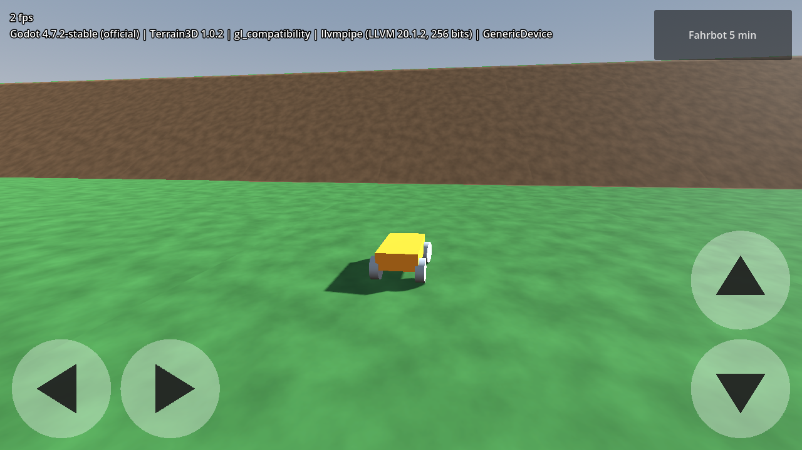

# Spike-Tag – Ablauf und Messprotokoll

**Ziel:** H1 entscheiden (Godot 4.7.2 + Terrain3D 1.0.2 auf Windows **und** Android im Mobile-Renderer)
und die erste Messung für H4 (≥ 30 fps auf dem Einsteiger-Android) machen.
**Dauer:** ca. 3–4 Stunden. **Ergebnis:** ausgefülltes Protokoll unten + Entscheidung in
[ADR 0001](../decisions/0001-godot-version-pin.md).



## Vorab erledigt (Cloud, 25.10.2026)

Getestet mit Godot 4.7.2-stable (Linux) und Terrain3D 1.0.2-stable:

| Prüfung | Ergebnis |
|---|---|
| Terrain3D 1.0.2 nennt Godot-Unterstützung | **4.4–4.7** (Release-Notes inzwischen aktualisiert; der Plan ging noch von „4.4–4.6+“ aus) |
| Terrain3D lädt als GDExtension in Godot 4.7.2 | ✅ |
| Region per Code erzeugen, Höhen lesen, Kollision `FULL_GAME` | ✅ |
| Kollision Terrain3D + Jolt: Fahrzeug parkt quer am 35°-Hang | ✅ 0,0 mm Drift in 10 s |
| Fahrbot, alle 14 Metriken | ✅ (Tabelle in [ADR 0002](../decisions/0002-rad-controller.md)) |
| Rendering Compatibility/OpenGL (Software-GPU) | ✅ siehe Bild oben |
| Rendering **Mobile/Vulkan** (Software-GPU llvmpipe) | ❌ Absturz, aber **identisch** mit Godot 4.6.3 + Terrain3D 1.0.2 und mit Terrain3D 1.1.0-rc1 → Problem der Software-GPU, kein Versionsproblem. **Auf echter Hardware offen.** |
| Warnung `instance_reset_physics_interpolation() is deprecated` | harmlos: Terrain3D 1.0.2 nutzt eine alte API, Godot 4.7 hat dafür eine Kompatibilitätsschicht |
| Export-Presets Windows/Android werden erkannt | ✅ (Templates und Android-SDK fehlen in der Cloud, das ist erwartet) |

## Vorbereitung (vor dem Tag, ca. 1 h)

1. **Godot 4.7.2-stable** für Windows (Standard-Version, nicht .NET) installieren.
   Im Editor: *Editor → Export-Vorlagen verwalten → Herunterladen und installieren* (4.7.2).
2. **Repo holen und Terrain3D laden** (PowerShell):
   ```powershell
   git clone https://github.com/brummilab/Kraxl
   cd Kraxl
   .\tools\fetch_terrain3d.ps1
   ```
   In Git Bash zusätzlich `sh scripts/install-hooks.sh`.
3. **Android-Werkzeuge** nach der Godot-Doku „Exporting for Android“ (Version 4.7): JDK 17 und Android-SDK
   (platform-tools, build-tools) installieren, Pfade unter *Editor → Editoreinstellungen → Export → Android*
   eintragen. Ein Debug-Keystore genügt für den Spike.
4. **Android-Gerät:** Entwickleroptionen und USB-Debugging aktivieren. Ideal ist ein Einsteigergerät der
   Mali-G52/Adreno-610-Klasse (ADR 0004). Modell, GPU und Android-Version unten notieren.

## Ablauf am Tag

| # | Block | Zeit | Was genau | Bestanden, wenn |
|---|---|---|---|---|
| 1 | Windows Editor | 30 min | Projekt öffnen; Ausgabe-Panel auf Fehler prüfen; *Projekt → Projekteinstellungen → Plugins*: Terrain3D aktiv. **F5** startet die Garage, Zielflagge → Spike-Szene. Mit Pfeiltasten/WASD fahren, die Touch-Tasten mit der Maus testen, an den Osthang fahren (rechts vom Start) | Terrain mit Wiese/Erde sichtbar, keine Shader-Fehler, Fahrzeug fährt und parkt am Hang ruhig |
| 2 | 1 Region malen | 30 min | Neue Szene → Node `Terrain3D` → Datenordner `res://terrain/spike_data` → Region hinzufügen → Höhe malen, 2 Texturen setzen, speichern | Malen und Speichern ohne Absturz, Region lädt nach Neustart |
| 3 | Fahrbot auf Windows | 15 min | `tests/fahrbot/fahrbot.tscn` öffnen, **F6** | Tabelle in der Ausgabe, alle Metriken ✅ (sonst Werte notieren) |
| 4 | Android: läuft es? | 45 min | Gerät per USB, im Editor oben rechts *Remote Debug / Ein-Klick-Deploy* auf Android | Spike-Szene startet, Statuszeile zeigt `mobile` und die echte GPU, Steuerung per Touch funktioniert |
| 5 | Android: 5-min-Runde | 15 min | Knopf **„Fahrbot 5 min“** oben rechts, Gerät nicht anfassen. Ergebnis steht am Bildschirm und im Ausgabe-Panel (`[Spike] …`) | **1%-Low ≥ 30 fps** |
| 6 | Berechtigungs-Gate | 15 min | *Projekt → Exportieren → Android → Projekt exportieren* (Debug) nach `build/android/Kraxl.apk`, dann `.\tools\check_apk_permissions.ps1 build\android\Kraxl.apk` | „OK: … verlangt keine Berechtigungen“ |
| 7 | Gamepad | 15 min | 8BitDo SN30 Pro am PC (Start + X, X-Input) und am Android-Gerät (Bluetooth, Start + B): Prüfliste aus [ADR 0009](../decisions/0009-gamepad-8bitdo.md) | Alle Zeilen der Belegungstabelle funktionieren |
| 8 | Entscheidung | 15 min | Protokoll ausfüllen, ADR 0001 aktualisieren | – |

Hinweis zu Block 6: Nicht das APK aus dem Ein-Klick-Deploy prüfen. Für Remote-Debugging fügt Godot
absichtlich `INTERNET` hinzu.

## Entscheidungsbaum

- **Windows ✅ und Android ✅:** Godot 4.7.2 + Terrain3D 1.0.2 sind final. ADR 0001 auf „angenommen“ setzen.
- **Absturz oder Shader-Fehler nur mit 4.7.2:** Dasselbe Projekt mit **Godot 4.6.3** öffnen (Warnung wegen
  `config/features` „4.7“ bestätigen). Läuft es dort, ist 4.6.3 die Rückfallebene: `.tool-versions`,
  `project.godot`, README und CI anpassen.
- **Nur Android scheitert, auch mit 4.6.3:** Terrain3D **1.1.0-rc1** testen (unterstützt Godot 4.5–4.8,
  „better web and mobile support“). Das finale 1.1.0 ist laut Release-Notes „in a couple of weeks“ angekündigt.
  Ein RC kommt nicht in `main`, nur in einen Test-Branch.
- **Läuft, aber < 30 fps:** In dieser Reihenfolge drehen und jeweils neu messen:
  1. Schatten der Sonne aus (`shadow_enabled`)
  2. Render-Skalierung 0,75 (*Projekteinstellungen → Rendering → Skalierung 3D*)
  3. Terrain3D `mesh_lods` / `mesh_size` kleiner
  4. Texturgröße 512² → 256²

  **Kein** Wechsel auf Compatibility (ADR 0004).

## Messprotokoll

**Datum:** ______ **Durchgeführt von:** ______

| Feld | Windows | Android |
|---|---|---|
| Gerät / GPU | | |
| Android-Version / Treiber | | |
| Godot-Version | 4.7.2-stable | 4.7.2-stable |
| Terrain3D-Version | 1.0.2 | 1.0.2 |
| Renderer laut Statuszeile | | |
| Szene startet ohne Fehler | ☐ | ☐ |
| Terrain + Texturen korrekt | ☐ | ☐ |
| Region malen + speichern (nur Editor) | ☐ | – |
| Fahrbot-Tabelle alle ✅ | ☐ | – |
| 5-min-Runde Ø / 1%-Low / Min fps | | |
| APK ohne Berechtigungen | – | ☐ |
| 8BitDo SN30 Pro (Modus) | | |
| Auffälligkeiten | | |

**Entscheidung:** ☐ 4.7.2 + Terrain3D 1.0.2  ☐ Rückfall 4.6.3  ☐ Terrain3D 1.1.x prüfen
